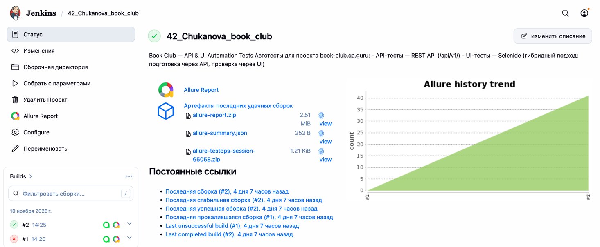
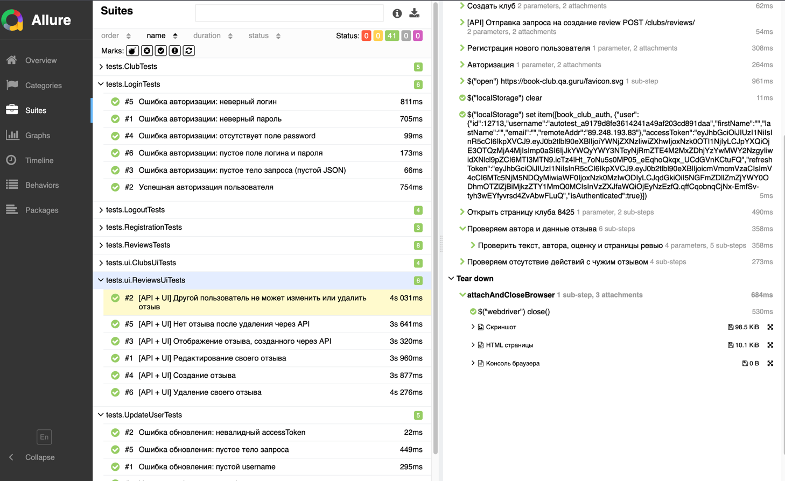
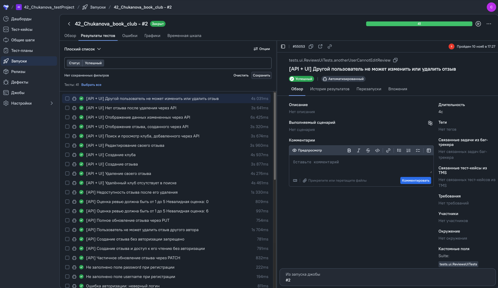
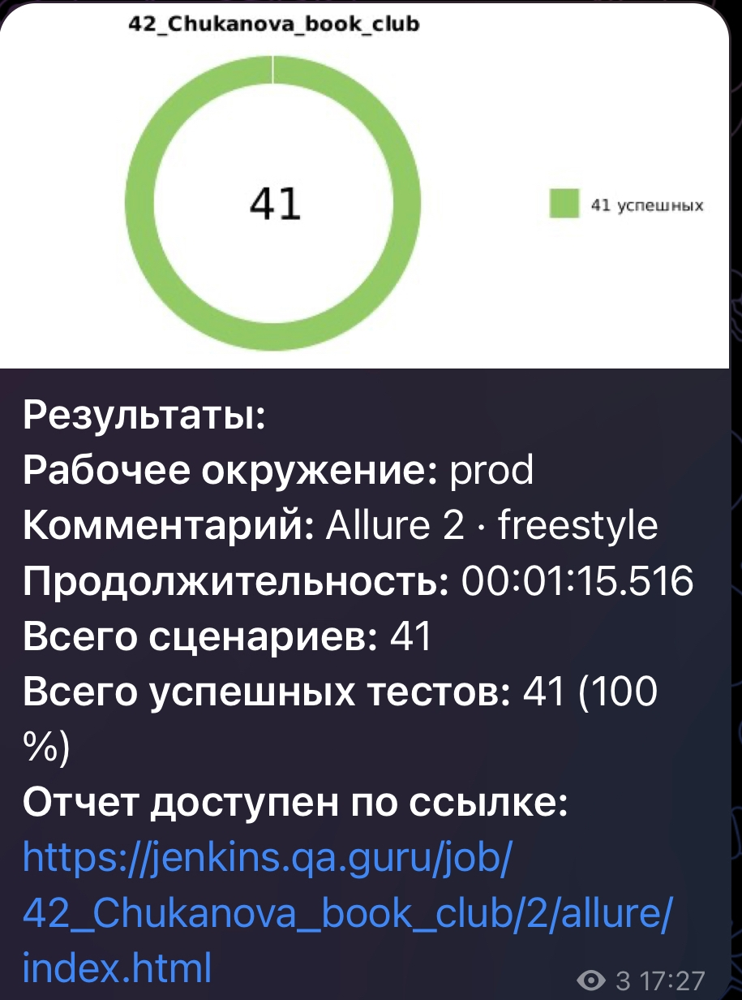

<h1 align="center">📚 Book Club</h1>
<p align="center"><strong>Демо-проект по автоматизации тестирования</strong></p>

<p align="center">
  Автотесты API и пользовательского интерфейса сервиса книжных клубов
</p>

<p align="center">
  
  
  
  
  
  
  
</p>

В проекте собраны API- и UI-тесты [Book Club](https://book-club.qa.guru). Данные для UI-сценариев подготавливаются через API.

<p align="center">
  <a href="#tools">Технологии</a> ·
  <a href="#cases">Проверки</a> ·
  <a href="#jenkins">Jenkins</a> ·
  <a href="#console">Запуск автотестов</a><br>
  <a href="#allure">Allure Report</a> ·
  <a href="#allure-testops">Allure TestOps</a> ·
  <a href="#telegram">Telegram</a> ·
  <a href="#video">Видео в Selenoid</a>
</p>

---

<a id="tools"></a>

## 🛠️ Технологии

Java 17 · JUnit 5 · REST Assured · Selenide · AssertJ · Jackson · Datafaker · Gradle · Allure · Jenkins · Selenoid.

UI-тесты используют Page Object, ответы API проверяются в том числе по JSON-схемам.

---

<a id="cases"></a>

## ✅ Проверки

### API

- [x] Регистрация, авторизация и выход из системы.
- [x] Обновление профиля пользователя.
- [x] Создание, просмотр, изменение и удаление клубов и отзывов.
- [x] Валидация данных и права доступа.

### API + UI

- [x] Поиск и просмотр клуба, созданного через API.
- [x] Отображение изменений и удаления данных.
- [x] Создание клуба через интерфейс.
- [x] Создание, изменение и удаление отзывов в браузере.
- [x] Отсутствие действий редактирования и удаления чужого отзыва.

---

<a id="jenkins"></a>

## ⚙️ Параметры сборки в Jenkins

[Открыть проект в Jenkins](https://jenkins.qa.guru/job/42_Chukanova_book_club/)

<p align="center">
  <a href="https://jenkins.qa.guru/job/42_Chukanova_book_club/"></a>
</p>

| Параметр | Описание |
| --- | --- |
| `browser` | Браузер, по умолчанию `chrome` |
| `browserVersion` | Версия браузера |
| `browserSize` | Размер окна, по умолчанию `1920x1080` |
| `baseUrl` | Адрес приложения, по умолчанию `https://book-club.qa.guru` |
| `remoteUrl` | Адрес сервера Selenium / Selenoid, при необходимости с логином и паролем |
| `headless` | Запуск без окна браузера, по умолчанию `true` |

---

<a id="console"></a>

## 🚀 Запуск автотестов

### ☁️ Удалённый запуск (Selenoid)

Запуск тестов в Selenoid с использованием конфигурации по умолчанию:

```bash
./gradlew clean test
```

### 🖥️ Локальный запуск

Запуск тестов в локальном браузере без удалённого подключения и с отключённым Headless-режимом:

```bash
./gradlew clean test -Dremote= -Dheadless=false
```

---

<a id="allure"></a>

## 📊 Allure Report

[Посмотреть Allure-отчёт](https://jenkins.qa.guru/job/42_Chukanova_book_club/2/allure/)

После запуска тестов:

```bash
./gradlew allureServe
```

Отчёт содержит шаги, HTTP-запросы и ответы, а для UI — скриншоты, HTML страницы и логи браузера. Результаты сохраняются в `build/allure-results`.

<p align="center">
  <a href="https://jenkins.qa.guru/job/42_Chukanova_book_club/2/allure/"></a>
</p>

---

<a id="allure-testops"></a>

## 🧪 Allure TestOps

[Посмотреть запуск](https://allure.qa.guru/launch/57056) — результаты автотестов и тест-кейсы.

<p align="center">
  <a href="https://allure.qa.guru/launch/57056"></a>
</p>

---

<a id="telegram"></a>

## 🔔 Telegram

После сборки Telegram-бот отправляет результаты тестов и ссылку на Allure-отчёт.

<p align="center">
  
</p>

<a id="video"></a>
